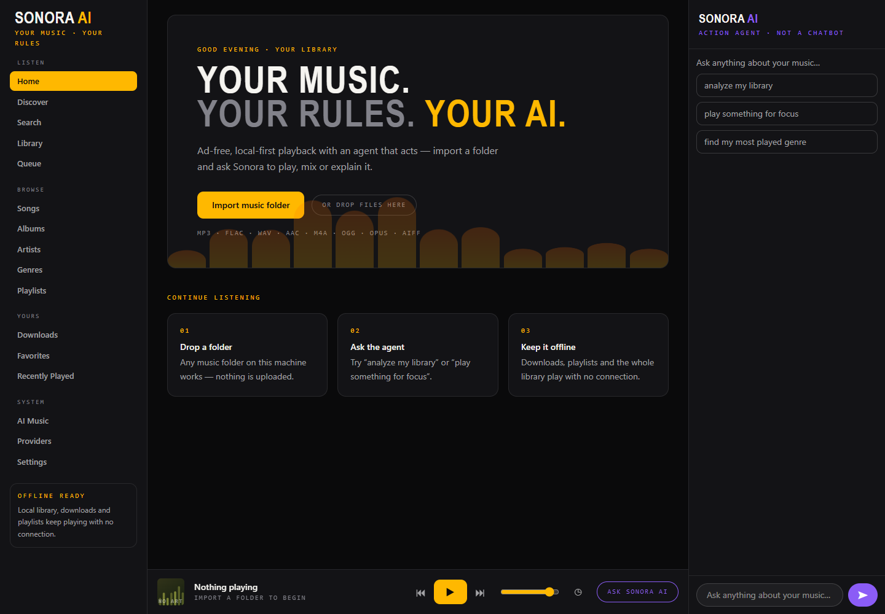
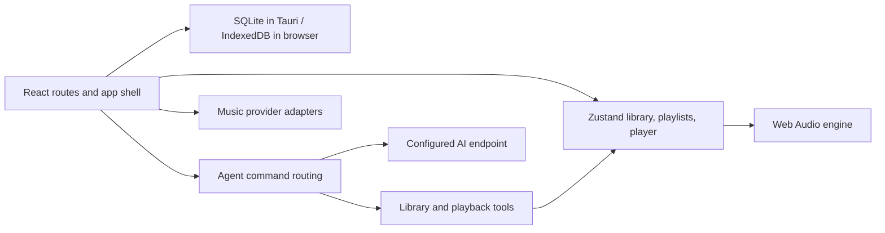

# SONORA AI

A local-first React/TypeScript music-player prototype with a Tauri desktop shell, Web Audio playback, playlists, lyrics, provider adapters, and configurable AI endpoints.



Captured from the real local web app on 2026-11-10 at 1440×1000 with a fresh browser context, no imported music, no credentials, and external requests blocked. The screenshot demonstrates the shell and empty state, not playback or a connected provider.

## Run and verify

Use a Node version supported by the locked Vite toolchain (the local audit used Node 24.18.0).

```sh
cd frontend
npm ci --ignore-scripts
npm run dev -- --host 127.0.0.1
npm test
npm run build
npm run lint
```

The audit passed all 9 tests and the TypeScript/Vite production build. Lint exits successfully with an existing LyricsPanel effect warning. Build warnings include bundle size, ineffective dynamic imports, and direct eval in a metadata dependency. The repair makes repeated pause and resume tool commands preserve the requested state instead of toggling it. The mobile AI panel now includes an explicit Close control, and Escape dismisses overlays; the real-browser open/close regression passed. Revert the audit commit to roll back.

## How the implementation fits together



The agent handles a small set of local intents and otherwise requests text from a configured provider. The current `runAgent` implementation does not parse arbitrary model tool calls, so the presence of a tool registry is not a general autonomous execution loop. Provider integrations and browser speech APIs depend on their own credentials, availability, and platform support. Mock and gated adapters remain present.

## Boundaries

Browser build/test success does not verify a Tauri desktop installer, Android APK, OS keyring, filesystem permissions, gapless playback, or crossfade quality. This audit did not access personal folders, import or download real music, sign into services, test media keys, or call AI/music providers. Use files you have rights to when testing playback.

AI provider configuration currently persists API keys in browser localStorage. This path is not OS-keyring storage; see [security notes](SECURITY.md) before configuring credentials.

Project notes: [architecture](ARCHITECTURE.md), [development](DEVELOPMENT.md), [providers](API_PROVIDERS.md), [agent](AI_AGENT.md), [voice](VOICE.md), [security](SECURITY.md), and [Android](docs/ANDROID.md). These describe intended capabilities; verify platform-specific claims against the current source and an actual device build.
